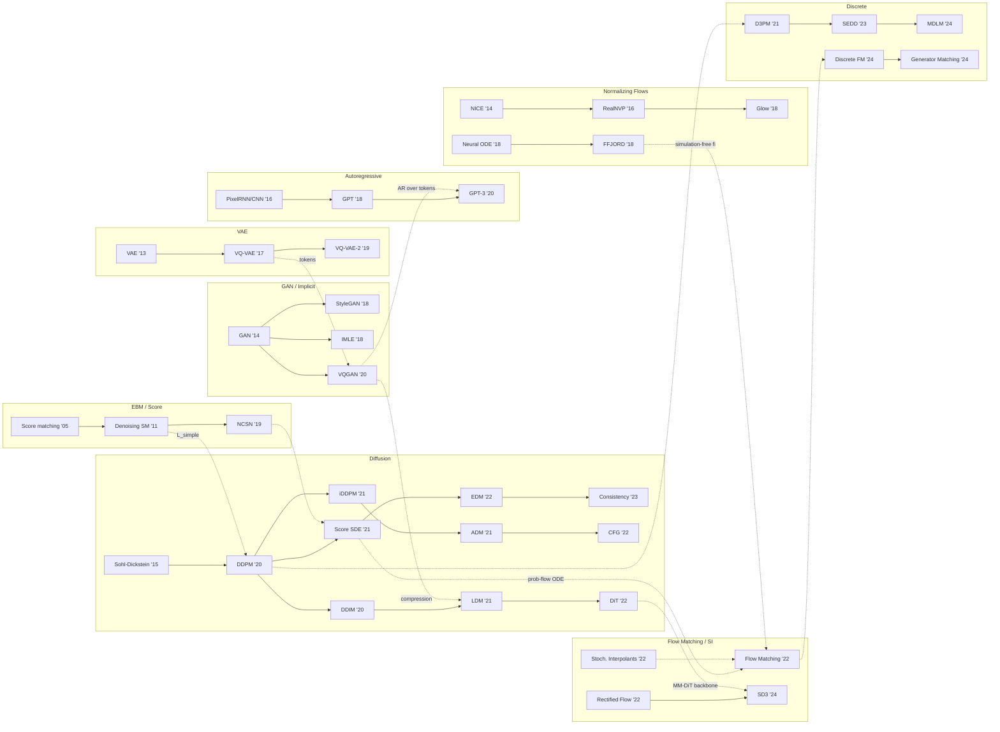

### [[dl_moc]]  
# **Generative Modeling**

**Tags**:: #generative #dl_theo
**Links**:: [[Flow Matching]] · [[Score Matching]] · [[DDPM]] · [[DDIM]] · [[Score-Based Generative Modeling Methods]] · [[VAE]] · [[Autoencoder]] · [[GAN]] · [[IMLE]] · [[VQ-VAE]] · [[RAE]] · [[LDM]] · [[DiT]] · [[GPTs]] · [[LLMs]] · [[ELBO]] · [[FID]] · [[MCMC]]

**Generative modeling** is the task of learning to *sample* from an unknown data distribution $p_\text{data}$, given only a finite dataset of examples. This hub note defines the problem, maps the **model families** and their landmark literature to the vault's notes, and summarizes [MIT 6.S184](https://diffusion.csail.mit.edu/2026/index.html) guide to reading the diffusion/flow literature.

## Generation as Sampling
---
Four key ideas (6.S184 §1.3):
1. **Objects as vectors**: images, videos, molecules — anything generated is represented as $z \in \mathbb{R}^d$ (text is the discrete exception).
2. **Generation = sampling**: "how good is this dog image" becomes "how likely is it under $p_\text{data}$"; generating means drawing $z \sim p_\text{data}$.
3. **Dataset = samples**: we never see $p_\text{data}$ itself, only $z_1, \dots, z_N \sim p_\text{data}$ i.i.d.
4. **Guided generation**: sample from a conditional $p_\text{data}(\cdot|y)$ (prompt, class, observation); one model conditions on arbitrary $y$, and unconditional techniques generalize directly (see guidance in [[Flow Matching]]).

A **generative model** is any algorithm that (approximately) returns such samples. The families below differ in *what they parameterize* — a density, a score, a velocity field, a sampler — and pay for it in different currencies: likelihood access, sample quality, mode coverage, and sampling speed.

## The Model Families
---
**Autoregressive models.** Factorize exactly: $p(z) = \prod_i p(z_i \mid z_{<i})$, train by next-token cross-entropy, sample sequentially. [[Transformer]]-based [[GPTs]]/[[LLMs]] made this *the* paradigm for text ([[BPE]] tokens, [[PPL]] evaluation). Exact likelihood, stable training; sampling is inherently serial and continuous data must be discretized ([[VQ-VAE]] tokens bridge the gap).
- *Methods:* [PixelRNN/PixelCNN (2016)](https://arxiv.org/abs/1601.06759) · [WaveNet (2016, audio)](https://arxiv.org/abs/1609.03499) · GPT (2018) → [GPT-3 (2020)](https://arxiv.org/abs/2005.14165) ([[GPTs]]) · AR over [VQGAN (2020)](https://arxiv.org/abs/2012.09841) tokens

**Energy-based & score-based models.** Parameterize an unnormalized density $p_\theta \propto e^{-f_\theta}$; the intractable $Z_\theta$ motivates working with the **score** $\nabla\log p$ instead — Langevin sampling ([[MCMC]]), annealed noise scales. Vault: [[Score-Based Generative Modeling Methods]] (broad picture), [[Score Matching]] (training algorithm).
- *Methods:* score matching (Hyvärinen, 2005; [[Divergence Theorem]]) · denoising score matching (Vincent, 2011) · [deep EBMs (2019)](https://arxiv.org/abs/1903.08689) · [NCSN (2019)](https://arxiv.org/abs/1907.05600)

**Variational autoencoders.** Latent-variable models $p_\theta(x) = \int p_\theta(x|z)p_\text{prior}(z)dz$ trained by maximizing the [[ELBO]] with an amortized encoder. Fast sampling, structured latents, blurry outputs; today mostly the **compression stage** of latent generative models. Vault: [[VAE]], [[Autoencoder]], [[VQ-VAE]] (discrete codebooks), [[RAE]] (deterministic alternative).
- *Methods:* [VAE (2013)](https://arxiv.org/abs/1312.6114) · β-VAE (ICLR 2017) · [VQ-VAE (2017)](https://arxiv.org/abs/1711.00937) · [VQ-VAE-2 (2019)](https://arxiv.org/abs/1906.00446) · [NVAE (2020)](https://arxiv.org/abs/2007.03898)

**GANs & implicit models.** A generator maps noise to samples with no likelihood; GANs train it adversarially against a discriminator ([Goodfellow et al., 2014](https://arxiv.org/abs/1406.2661)). Sharp one-step samples; unstable training, mode collapse. Survives inside hybrids — VQGAN's adversarial loss sharpens autoencoders ([[Autoencoder]], [[LDM]]). **[[IMLE]]** trains the same implicit sampler *non-adversarially* — match every data point to its nearest generated sample — mode-covering by construction, the strong option for few-shot generation. Vault: [[GAN]], [[IMLE]].
- *Methods:* [GAN (2014)](https://arxiv.org/abs/1406.2661) · [DCGAN (2015)](https://arxiv.org/abs/1511.06434) · [WGAN (2017)](https://arxiv.org/abs/1701.07875) · [ProGAN (2017)](https://arxiv.org/abs/1710.10196) · [IMLE (2018)](https://arxiv.org/abs/1809.09087) · [StyleGAN (2018)](https://arxiv.org/abs/1812.04948) · [BigGAN (2018)](https://arxiv.org/abs/1809.11096) · [VQGAN (2020)](https://arxiv.org/abs/2012.09841)

**Normalizing flows.** Invertible maps give exact likelihoods via change of variables ($\log|\det J|$); continuous-time CNFs (defined in [[ODEs, SDEs, and Probability Paths#Flow Models]]) replace layers with an ODE but needed in-training simulation — the bottleneck [[Flow Matching]] removed.
- *Methods:* [NICE (2014)](https://arxiv.org/abs/1410.8516) · [RealNVP (2016)](https://arxiv.org/abs/1605.08803) · [Glow (2018)](https://arxiv.org/abs/1807.03039) · [Neural ODE (2018)](https://arxiv.org/abs/1806.07366) · [FFJORD (2018)](https://arxiv.org/abs/1810.01367)

**Diffusion models.** Corrupt data with a forward noising process, learn to denoise; trained by denoising [[Score Matching]]. State-of-the-art quality and diversity, many-step sampling. Vault: [[DDPM]], [[DDIM]], [[LDM]], [[DiT]].
- *Methods:* [Sohl-Dickstein et al. (2015)](https://arxiv.org/abs/1503.03585) · [DDPM (2020)](https://arxiv.org/abs/2006.11239) · [DDIM (2020)](https://arxiv.org/abs/2010.02502) · [score SDE (2021)](https://arxiv.org/abs/2011.13456) · [improved DDPM (2021)](https://arxiv.org/abs/2102.09672) · [ADM + classifier guidance (2021)](https://arxiv.org/abs/2105.05233) · [LDM (2021)](https://arxiv.org/abs/2112.10752) · [classifier-free guidance (2022)](https://arxiv.org/abs/2207.12598) · [EDM (2022)](https://arxiv.org/abs/2206.00364) · [DiT (2022)](https://arxiv.org/abs/2212.09748) · [consistency models (2023)](https://arxiv.org/abs/2303.01469)

**Flow matching & stochastic interpolants.** Regress a velocity field generating a chosen probability path — simulation-free CNF training. Subsumes diffusion as a special case, allows arbitrary source distributions, ODE sampling. Vault: [[Flow Matching]] (the full treatment), current backbone of SD3/FLUX/Movie Gen/π0.
- *Methods:* [rectified flow (2022)](https://arxiv.org/abs/2209.03003) · [stochastic interpolants (2022)](https://arxiv.org/abs/2209.15571) · [flow matching (2022)](https://arxiv.org/abs/2210.02747) · [SD3 (2024)](https://arxiv.org/abs/2403.03206) · [FM guide & code (2024)](https://arxiv.org/abs/2412.06264)

**Discrete diffusion / discrete FM.** [[CTMC]]-based generation for tokens (masking/uniform noising with rate matrices) — the diffusion-style route to language modeling and multimodal generation; see [[Flow Matching]] (Discrete FM section) and [[Discrete Flow Matching]].
- *Methods:* [D3PM (2021)](https://arxiv.org/abs/2107.03006) · [SEDD (2023)](https://arxiv.org/abs/2310.16834) · [MDLM (2024)](https://arxiv.org/abs/2406.07524) · [Discrete FM (2024)](https://arxiv.org/abs/2407.15595) · [Generator Matching (2024)](https://arxiv.org/abs/2410.20587) — the last unifies flows, diffusions, jumps, and CTMCs as one framework: any Markov generator, one conditional-Bregman training recipe (see [[Flow Matching]]).

| Family | Parameterizes | Likelihood | Sampling | Weakness | Vault |
|---|---|---|---|---|---|
| Autoregressive | $p(z_i\|z_{<i})$ | exact | serial | slow for long/continuous data | [[GPTs]] [[LLMs]] |
| EBM / score | energy / score | unnormalized | Langevin ([[MCMC]]) | mixing, $Z_\theta$ | [[Score-Based Generative Modeling Methods]] |
| VAE | decoder + amortized posterior | [[ELBO]] bound | 1 step | blurry, posterior collapse | [[VAE]] |
| GAN | sampler only | none | 1 step | instability, mode collapse | [[GAN]] |
| IMLE | sampler only | none (implicit MLE) | 1 step | metric-dependent sharpness | [[IMLE]] |
| Normalizing flow | invertible map | exact | 1 pass | restricted architectures | — |
| Diffusion | score along a path | exact (ODE) / ELBO (SDE) | many steps | sampling cost | [[DDPM]] [[Score Matching]] |
| Flow matching | velocity along a path | exact, unbiased | ODE steps (few) | — | [[Flow Matching]] |

## Lineage Digraph (by publication year)
---
Solid arrows = direct lineage within a family; dashed arrows = a method from one family enabling or being absorbed into another. Left-to-right ≈ publication time.

## Reading the Literature: One Family, Many Dialects
---
Diffusion/flow papers describe *the same models* in different languages (6.S184 App. E; Summary 45). The four axes to translate:

1. **Discrete vs. continuous time.** Early diffusion (Sohl-Dickstein 2015, DDPM) used discrete-time Markov chains with an [[ELBO]] loss — a *lower bound* that forces choosing the discretization before training. In continuous time the bound becomes **tight** (the FM/SM theorems are equalities), and solvers/step counts become post-training choices.
2. **Time convention.** Diffusion papers put data at $t = 0$ and noise at $t \to \infty$; FM runs $t=0$ noise → $t=1$ data. Pure notation, endless confusion.
3. **"Forward process" vs. probability paths.** A forward noising SDE (always with affine drift, so marginals stay Gaussian in closed form) is just one *construction* of a Gaussian probability path — it is never actually simulated during training, and only reaches the Gaussian as $t \to \infty$. The probability-path language ([[Flow Matching]]) is both simpler and more general (arbitrary $p_\text{init}$, non-Gaussian paths).
4. **Time-reversal vs. solving the Fokker–Planck equation.** The classical route builds the sampler as Anderson's time-reversal of the forward SDE; but generation only needs the *marginals* reversed, i.e. any solution of the Continuity/Fokker–Planck equation — a strictly easier problem, whose non-time-reversal solutions (probability-flow ODE) often sample better.

Framework dictionary: **DDPM** = discrete time + forward process + ELBO; **score SDE** = continuous time + time-reversal + [[Score Matching]]; **Flow Matching** = probability paths + velocity regression, deterministic sampling; **stochastic interpolants** = FM + the Langevin SDE extension; **rectified flow** = FM with cond-OT paths + re-coupling (reflow). All train the same conditional-expectation regression at heart.

## The Modern Stack
---
State-of-the-art image/video generation composes the families rather than choosing one (see [[Autoencoder]] → Latent Generative Modeling, [[LDM]]):

1. **Compression**: a [[VAE]]/VQGAN autoencoder (β ≪ 1, perceptual + adversarial losses) maps pixels to latents — division of labor set by the rFID/gFID trade-off.
2. **Generative core**: [[Flow Matching]] or diffusion in latent space, trained by conditional regression ([[Score Matching]] / CFM).
3. **Backbone**: [[DiT]] (or [[U-Net]]); MM-DiT for joint text–image attention.
4. **Guidance**: classifier-free guidance for prompt adherence.
5. **Evaluation**: [[FID]] (+ rFID/gFID), CLIP score; likelihoods where exact ([[ELBO]] otherwise).

Examples: SD3, FLUX (images), Movie Gen (video), Voicebox/Audiobox (audio), SE(3)-FM (proteins), π0 ([[VLA]] robot policies). Text remains autoregressive ([[LLMs]]) with discrete diffusion as the challenger.

**The generative learning trilemma** ([Xiao et al., 2021](https://arxiv.org/abs/2112.07804)): sample **quality**, mode **coverage/diversity**, and sampling **speed** — classically pick two (GANs: quality+speed; VAEs: coverage+speed; diffusion: quality+coverage). Few-step FM (reflow/distillation) is the current attempt to get all three.

## Relationship to Other Notes
---
- [[Flow Matching]] / [[Score Matching]] — the current-generation training algorithms (velocity- and score-side); FM note also covers discrete FM and Generator Matching
- [[DDPM]] / [[Score-Based Generative Modeling Methods]] — the diffusion lineage and its SDE view
- [[VAE]] / [[Autoencoder]] / [[VQ-VAE]] / [[RAE]] — latent-variable models and the compression stage of the modern stack
- [[GAN]] — adversarial implicit models; survives in autoencoder hybrids
- [[IMLE]] — non-adversarial training of implicit samplers by data→sample nearest-neighbor matching; mode-covering, few-shot niche
- [[LDM]] / [[DiT]] / [[U-Net]] — the latent-space pipeline and its backbones
- [[GPTs]] / [[LLMs]] / [[Transformer]] — autoregressive generation for text
- [[ELBO]] / [[KL Divergence]] / [[Divergence Theorem]] / [[MCMC]] — the mathematical toolkit (bounds, divergences, conservation laws, samplers)
- [[FID]] / [[PPL]] — evaluation for images and text respectively
- [[VLA]] — generative action models: flow matching as robot policy head
